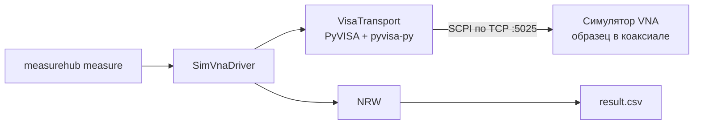

# MeasureHub

SCPI-симулятор векторного анализатора цепей (VNA), драйвер на PyVISA и восстановление ε и μ
методом Николсона–Росса–Вейра (NRW). Версия `v0.3.0`: REST API на FastAPI, PostgreSQL, фоновое
измерение воркером Celery, запуск одной командой `docker compose up` и отказоустойчивость
(повторы, возобновление, отмена, сторож), проверенная тестами с внедрением сбоев.



## Сервер: `docker compose up`

```bash
docker compose up --build
```

Поднимаются `postgres`, `redis`, `migrate` (Alembic и первый пользователь), `api` (порт 8000),
`worker`, `beat` (сторож и опрос приборов) и `simulator` (порт 5025). Документация API: <http://localhost:8000/docs>.
Пользователь для входа по умолчанию — `operator` / `operator-dev-password` (только для разработки;
задаётся `MH_BOOTSTRAP_USERNAME` и `MH_BOOTSTRAP_PASSWORD`, см. `deploy/.env.example`).

Измерение через API:

```bash
BASE=http://localhost:8000/api/v1
TOKEN=$(curl -s $BASE/auth/login -H 'Content-Type: application/json'   -d '{"username":"operator","password":"operator-dev-password"}' | python -c 'import sys,json;print(json.load(sys.stdin)["access_token"])')
AUTH="Authorization: Bearer $TOKEN"; JSON='Content-Type: application/json'

INSTR=$(curl -s $BASE/instruments -H "$AUTH" -H "$JSON"   -d '{"name":"sim","resource":"TCPIP0::simulator::5025::SOCKET","driver":"sim_vna"}' | python -c 'import sys,json;print(json.load(sys.stdin)["id"])')
METHOD=$(curl -s $BASE/methods -H "$AUTH" -H "$JSON" -d '{"name":"nrw-901","params":{"points":901}}' | python -c 'import sys,json;print(json.load(sys.stdin)["id"])')
SAMPLE=$(curl -s $BASE/samples -H "$AUTH" -H "$JSON" -d '{"code":"F-1","material":"ferrite","thickness_mm":3}' | python -c 'import sys,json;print(json.load(sys.stdin)["id"])')

JOB=$(curl -s $BASE/jobs -H "$AUTH" -H "$JSON"   -d "{\"instrument_id\":\"$INSTR\",\"method_id\":\"$METHOD\",\"sample_id\":\"$SAMPLE\"}" | python -c 'import sys,json;print(json.load(sys.stdin)["id"])')

curl -s $BASE/jobs/$JOB -H "$AUTH"                      # статус и прогресс
curl -s $BASE/jobs/$JOB/result -H "$AUTH"               # ε′, ε″, μ′, μ″ по частоте и сводка
curl -s "$BASE/jobs/$JOB/export?format=csv" -H "$AUTH" -o result.csv
```

Пока в API нет WebSocket: прогресс читается опросом `GET /jobs/{id}` (`status`, `points_done`).

```bash
curl -s -X POST $BASE/jobs/$JOB/cancel -H "$AUTH"   # отмена: после текущего сегмента
curl -s -X POST $BASE/jobs/$JOB/retry  -H "$AUTH"   # новое задание с теми же параметрами
```

## Отказоустойчивость

| Сбой | Что происходит |
| --- | --- |
| Обрыв связи, таймаут, ошибка прибора | Сегмент повторяется: переподключение, пауза 1, 2, 4 … с (не больше 30 с), до `max_retries` раз. Дальше задание `failed`, снятые точки остаются |
| Падение воркера | Сторож (раз в 30 с) возвращает `running` без heartbeat дольше 60 с в очередь, не больше двух раз, затем `failed` (`worker_lost`). Задание продолжается с первого несохранённого сегмента |
| Отмена | `cancelled` сразу, если задание ещё в очереди; иначе текущий сегмент дорабатывается и сохраняется |
| Прибор занят другим заданием | Блокировка в Redis, задание остаётся в `queued` и повторяется через 5 с |

Четыре сценария ТЗ (раздел 11.5) проверяются в `tests/integration/test_resilience.py` (в CI) и на
поднятом стеке в `tests/e2e` (воркер убивается `docker compose kill`):
обрыв 10% соединений, убийство воркера посередине, зависание прибора, отмена посередине. В каждом
сохранённые точки сравниваются с точной физической моделью, то есть потеря, дубль или порча
были бы замечены. Решения описаны в `docs/adr/ADR-003-segmented-measurement.md` и
`ADR-004-instrument-lock.md`.

Сбои симулятора задаются при запуске (`--fault-drop`, `--fault-hang`, `--fault-err`,
`--fault-latency-ms`, `--fault-seed`, или `MH_SIM_FAULT_*`) и командами `SIM:FAULT:DROP|HANG|ERR <p>`,
`SIM:FAULT:LAT <мс>`. Вероятность бросается на каждую принятую строку: обрыв закрывает соединение,
зависание оставляет строку без ответа, ошибка кладёт в очередь `-300` и не выполняет команду.

## Быстрый старт (CLI без сервера)

Нужен Python 3.12.

```bash
python -m venv .venv
.venv/Scripts/activate        # Linux/macOS: source .venv/bin/activate
pip install -e ".[dev]"
```

Измерение со встроенным симулятором (запускается сам, на свободном порту):

```bash
measurehub measure --sample "d_mm=3;eps=10,0.5;mu=1.5,0.2" --points 10001 --out result.csv
```

```text
instrument: MeasureHub,SIM-VNA-01,000001,1.0
10001 points -> result.csv
eps_re_mean: 10.0002  (true 10, error 0.00%)
eps_im_mean: 0.499766  (true 0.5, error 0.05%)
mu_re_mean: 1.49999  (true 1.5, error 0.00%)
mu_im_mean: 0.199983  (true 0.2, error 0.01%)
flagged_fraction: 0
```

Отдельный симулятор и подключение к нему по VISA:

```bash
measurehub-sim --port 5025 --eps 10,0.5 --mu 1.5,0.2 --thickness-mm 3
measurehub measure --resource "TCPIP0::localhost::5025::SOCKET" --sample "d_mm=3" --out result.csv
```

`--sample` — строка `d_mm=<толщина, мм>;eps=<ε′,ε″>;mu=<μ′,μ″>`. Для NRW нужна толщина; ε и μ
нужны только встроенному симулятору (и для сравнения с истиной в отчёте). Параметры развёртки:
`--start`, `--stop`, `--points`, `--ifbw`, `--averaging`, `--segment-size`. Обработчик:
`--processor nrw` (по умолчанию) или `raw` (|S| в дБ и фаза).

## Что внутри

| Путь | Содержимое |
| --- | --- |
| `simulator/model.py` | Прямая модель: S11, S21 образца в TEM-линии, шум σ = k·√(IFBW/1000)/√averaging |
| `simulator/scpi.py` | SCPI-интерпретатор: очередь ошибок, длинные и короткие формы команд, время развёртки |
| `simulator/server.py` | Асинхронный TCP-сервер (`\n`-терминатор) и запуск в потоке для тестов |
| `src/measurehub/drivers/` | Протокол драйвера, доменные исключения, транспорт PyVISA, `sim_vna`, сегменты |
| `src/measurehub/processing/` | Протокол и реестр обработчиков, `raw`, `nrw` — чистые функции |
| `src/measurehub/cli.py` | Команды `measurehub measure` и `measurehub create-user` |
| `src/measurehub/api/` | FastAPI: роутеры `/api/v1`, ошибки `problem+json`, `/health/*` |
| `src/measurehub/db/`, `migrations/` | ORM-модели SQLAlchemy 2 и миграции Alembic |
| `src/measurehub/worker/` | Celery, блокировка прибора в Redis, движок заданий |
| `deploy/`, `compose.yaml` | Dockerfile и Docker Compose |

### Соглашения

- Потери задаются как ε = ε′ − jε″, μ = μ′ − jμ″ (ε″, μ″ ≥ 0), время `e^{+jωt}`.
  Все интерфейсы (`SIM:SAMP:EPS <ε′>,<ε″>`, CSV) используют положительные ε″ и μ″.
- Ответ на `CALC:DATA:SDAT?`: `re,im` для всех точек S11, затем для всех точек S21.
- Неудачный запрос возвращает пустую строку, а причина лежит в `SYST:ERR?` — так клиент не ждёт таймаут.
- Развёртка из N точек делится на сегменты по `segment_size`; каждый сегмент — отдельные
  `STAR/STOP/POIN`, `INIT:IMM`, `*OPC?`, `CALC:DATA:SDAT?` и проверка `SYST:ERR?`.

### Ограничения NRW в v0.1.0

Фаза пропускания разворачивается по частоте, поэтому ветвь логарифма определяется, если первая
точка лежит в первой ветви. Точки, где толщина образца ≥ половины длины волны в материале,
помечаются флагом `phase_ambiguity` и не входят в средние значения. Точки с вырожденной
инверсией (например S11 = 0) получают флаг `invalid`.

## Разработка

```bash
ruff check . && ruff format --check . && mypy
pytest --cov
```

Приёмка этапа — `tests/integration/test_cli_acceptance.py`: CLI снимает 10 001 точку через
pyvisa-py (сегментами по 50), NRW восстанавливает ε′, ε″, μ′, μ″ с ошибкой ≤ 2% для трёх
наборов параметров образца. Тесты идут без Docker.

Тесты сервера идут на SQLite и fakeredis, симулятор поднимается в потоке. Проверка на реальных
PostgreSQL и Redis — приёмочный тест на поднятом стеке:

```bash
MH_E2E_URL=http://localhost:8000 pytest tests/e2e
```

Тест убийства воркера идёт быстрее с коротким сторожем: поднимите стек с
`MH_WATCHDOG_STALE_S=10 MH_WATCHDOG_INTERVAL_S=5`. В CI это делает job `e2e` (на `main` и по метке
`e2e` у pull request).

### Что пока не сделано (по плану фаз)

Роли и refresh-токен, версионирование методик, WebSocket, журнал событий задания, аудит,
повторная обработка результата (`reprocess`), клиент оператора.

## Лицензия

MIT
